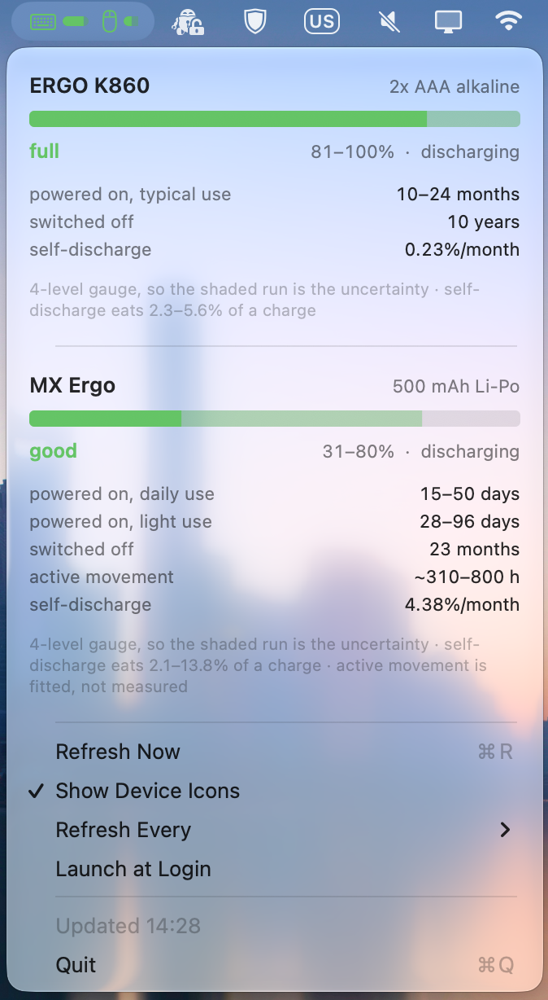

# Logitech battery levels on macOS

Unofficial project; not affiliated with Logitech. Licensed under the [MIT License](LICENSE).

Tested with ERGO K860 and MX Ergo through a Unifying receiver. Bolt and direct
Bluetooth connections have not been verified. Runtime figures are model-based
estimates, not measured remaining battery life.

Two ways to read the battery level of devices paired through a Logitech
**Unifying receiver**. Both pick the battery model from the device's name and
estimate how long the charge will actually last:

| | What it is | Where it lives |
|---|---|---|
| **`mxbattery`** | a single-file Python 3 script that prints a report | `./mxbattery` |
| **`LogiBattery.app`** | a native Swift menu bar app | built from `app/` |

The app is a Swift reimplementation of the script's reader rather than a wrapper
around it, and is verified against it — see
[`LogiBattery.app`](#logibatteryapp--the-menu-bar-app). Everything below about
gauge bands, calendar time and self-discharge applies to both.

### `mxbattery` — the script

```
$ ./mxbattery
  Logitech Unifying receiver · 2 devices
  ──────────────────────────────────────

  ERGO K860                                    2x AAA alkaline
  ████████████████▒▒▒▒  full · 81–100% · discharging

    powered on, typical use    10–24 months
    switched off               10 years              shelf life, not a charge
    self-discharge             0.23%/month           eats 2.3–5.6% of a charge
    4-level gauge · shaded cells = uncertainty

  MX Ergo                                        500 mAh Li-Po
  ████████████████▒▒▒▒  full · 81–100% · discharging

    powered on, daily use      38–63 days
    powered on, light use      73–120 days
    switched off               23 months             self-discharge only
    active movement            ~810–1000 h           fitted, not measured
    self-discharge             4.38%/month           eats 5.5–17.3% of a charge
    4-level gauge · shaded cells = uncertainty
```

```sh
./mxbattery              # full breakdown (above)
./mxbattery -b           # one line per device
./mxbattery --json       # machine-readable
./mxbattery -v           # + dump the raw HID++ frames
./mxbattery --ascii      # plain characters, for terminals without block glyphs
./mxbattery --days 90    # force one runtime-per-charge for every device
./mxbattery -h           # help
```

Colour is used only when stdout is a real terminal, and honours `NO_COLOR`.
Requires Python 3, which may need to be installed separately. No compiler, no pip packages,
no `brew`, no root, no entitlements, no Input-Monitoring/Accessibility prompt.
Exit status is `0` when at least one device was read, `1` otherwise.

### Reading the bar

The gauge has four steps, so a number like `90%` would be a lie — `90%` and
`100%` are the *same* reading. The bar shows that honestly by splitting into
three kinds of cell:

```
████████████████▒▒▒▒     full  · 81–100%    charge we can prove is there / the
██████▒▒▒▒▒▒▒▒▒▒░░░░     good  · 31–80%     band it is hiding in / definitely gone
██▒▒▒▒░░░░░░░░░░░░░░     low   · 11–30%
▒▒░░░░░░░░░░░░░░░░░░     critical · 0–10%
```

Solid = the charge floor the device guarantees. Shaded = the uncertainty.
Dim = consumed. On a fine-grained gauge the shaded run vanishes and the bar is
exact — and an all-dim bar means a genuinely empty battery, not an unknown one.

### A sleeping device is still listed

A device that has gone to sleep, or been switched off, answers nothing at all.
The receiver still remembers what is paired to each slot though — it replies in
~2 ms while the device itself is silent — so the script can tell *paired but
asleep* from *empty slot* and says so rather than quietly dropping it:

```
  ERGO K860                                    2x AAA alkaline
  ░░░░░░░░░░░░░░░░░░░░  no reading · asleep or switched off

    press a key or move it, then re-run
```

Exit status is `1` if no device could actually be read, even when some are
listed, so scripts do not mistake silence for a reading.

### `LogiBattery.app` — the menu bar app

A native readout of the same data: one `[icon][bar]` pair per paired device in
the menu bar, and a dropdown holding the full breakdown.



#### Build and run

Requires macOS 13 or later. To download a prebuilt universal app (Apple Silicon
and Intel), see [Releases](https://github.com/andyintheshell/logibattery/releases)
when a maintainer has published one. CI creates **draft** releases from the
`release` branch; drafts are not publicly downloadable until published.

**Warning: prebuilt apps are not Developer ID-signed or notarized by Apple.**
They carry only an ad-hoc integrity signature, so Gatekeeper may block them.
Only open builds you trust; alternatively review the source and build locally.
Do not disable Gatekeeper globally.

```sh
cd app
./build.sh                 # → ../LogiBattery.app  (compile, icon, bundle, sign)
./build.sh --icons         # ...and keep the .iconset and PNG previews
open ../LogiBattery.app
```

For a prebuilt download, open `LogiBattery-universal-macos.dmg`, drag the app to
the Applications shortcut, then eject the disk image. A ZIP is also available;
`SHA256SUMS.txt` contains checksums for both downloads. The DMG does not remove
the signing/notarization warning above.

For a universal build, use `ARCHS="arm64 x86_64" ./build.sh`. The GitHub Actions
workflow checks universal builds on PRs targeting `release`, then attaches the
DMG, zipped `.app`, and SHA-256 checksums to a new draft release after a merge/push to
`release`. It can also be run manually on that branch. PR builds never create
releases.

`build.sh` needs nothing but the Command Line Tools — no Xcode, no Developer
account, no provisioning profile. It compiles the Swift sources, renders and
packages the app icon, writes the `Info.plist`, and signs the bundle **ad-hoc**
(`codesign --sign -`):

```
$ codesign --verify --strict --verbose=2 LogiBattery.app
LogiBattery.app: valid on disk
LogiBattery.app: satisfies its Designated Requirement
```

An ad-hoc signature checks that the bundle has not been modified since it was
signed; it does not establish a developer identity or notarize the app. Building
locally needs no Apple Developer account. Downloaded builds may still be blocked
by Gatekeeper.

#### The app icon

The icon is the app's own thesis at icon scale: a battery whose fill is split
into the same three runs the menu bar draws.

That turned out to be harder than it sounds. Translucency encodes "unknown"
perfectly in the menu bar, where the bar sits on a *light* track — but the icon's
backdrop is dark, and a translucent green on dark just reads as *less* green. The
guess would have said `60% charged` rather than `60% known`. So the guessed run
is drawn at full brightness and then **hatched** back to let the track through:
bright enough to say "there is charge here", striped enough to say "not all of it
is accounted for". All three states are on show, because the distinction between
them is the point.

`app/icon/main.swift` draws every size natively from one set of 1024-unit
geometry instead of downscaling a single big render, which keeps the small icons
crisp. Below ~32 px the terminal nub falls under a pixel and softens into a
smudge — the right thing for a detail that small to do. It writes a standard
`.iconset` and leaves the packaging to `iconutil`.

Two ordering details: the icon is generated *after* the sources compile and
*before* signing, because the signature seals `Resources/` and an icon added
afterwards would invalidate it. And although the app is `LSUIElement` (no Dock
icon), this is the image Finder, Activity Monitor and the Login Items pane show.

`--icons` keeps the rendered `.iconset` and per-size PNG previews in `app/build/`
so the drawing can be checked without squinting at a 16 px tile.

#### In the menu bar

- **A symbol then a bar, per device.** Each device is an SF Symbol
  (`computermouse` or `keyboard`, tinted by its band) followed by a 16 pt charge
  bar. *Show Device Icons* in the dropdown switches to bars only, roughly halving
  the width for a crowded menu bar.
- **The bar is the same three-part bar as the script, drawn rather than typed**:
  solid = the charge floor, faded = the band it is hiding in, empty track =
  definitely gone. Colour carries only urgency — green for `full`/`good`, orange
  for `low`, red for `critical` — because the bar's *length* already separates
  81–100% from 31–80%.
- **A sleeping device stays visible, dimmed.** Nothing would otherwise
  distinguish "keyboard switched off" from "keyboard fine", so its symbol and bar
  grey out instead of vanishing.
- **Tooltip** on hover: name, band, range and charge status, one line per device.

One trap worth recording, because it was silent and only a screenshot caught it:
**SF Symbols are measured in font point size, not pixels.** Reserving 12 pt for a
12 pt `keyboard` glyph is wrong — the glyph is several points wider than its
point size — so the bar drawn after it overran the canvas and *every* bar lost
its right-hand end, which on a coarse gauge is the entire "not known" run. Each
symbol is now scaled into a fixed box, so the reserved width is the drawn width
by construction, and `--dump-png` prints each layout's size to keep a regression
visible in the build output.

#### In the dropdown

The same breakdown the script prints, laid out natively. Per device: name and
battery type, the wide bar, band and range, then the runtime scenarios,
`switched off`, `active movement` and `self-discharge`, with the caveats
underneath. Then *Refresh Now*, *Show Device Icons*, *Refresh Every*
(1/5/15/30 minutes), *Launch at Login* and *Quit*.

Reading happens on a background thread with its own run loop, so the menu never
blocks: the IOKit report callback needs a run loop, and running that on the main
thread would freeze the menu for up to a second whenever a device is slow to
answer. The dropdown re-reads when the cached data is more than 20 s old.

Two things it has to be honest about:

- **The menu bar cannot show an exact percentage**, for the same reason the
  script cannot: both devices report a 4-step gauge. A number up there would be
  invented precision, which is why the bar is shaded and the dropdown says
  `31–80%`.
- **Launch at Login** goes through `SMAppService`, and macOS is happiest when the
  app is where apps live. If it refuses, move the bundle to `/Applications`.

#### What it costs

Measured on this machine, because "it's only a little menu bar app" is a claim
that deserves a number.

| | |
|---|---|
| Idle CPU | **0.0%** |
| Physical footprint | **15–16 MB**, flat |
| CPU per refresh | **~17 ms** at a 5 s interval, **~26 ms** at 1 s |
| Idle wakeups | **~2 per refresh** |
| A bare read, cold process | 16.0 ms CPU, 9 MB peak RSS |

The refresh is the *only* thing it does. There is no polling loop and no HID
handle held open between reads: `readDevices()` builds a `Receiver`, reads it,
and drops it, so the receiver is closed and idle in between.

At the 30-minute interval set here that is 48 refreshes a day. Annualised,
using the conservative 26 ms figure throughout:

| interval | refreshes/day | CPU/day | CPU/year |
|---|---|---|---|
| 60 s | 1,440 | 37 s | ~3.8 hours |
| 5 min (default) | 288 | 7.5 s | ~46 minutes |
| 30 min | 48 | 1.3 s | **~7 minutes** |

Memory is the part worth testing properly, because a long-running app fails by
growing. 400 refreshes back to back — about eight days of real use at two an
hour — left the physical footprint oscillating inside 0.4 MB with **no upward
trend at all** (16.0 → 16.1 MB).

Three things worth knowing:

- **RSS is the wrong number, and it is easy to quote by accident.** `ps` reports
  ~52 MB here. That counts shared framework pages every process maps; the
  figure that actually costs the system is `phys_footprint`, and it is 15 MB.
- **Per-refresh cost depends on the interval**, which I did not expect. The same
  read costs ~17 ms when refreshes are 5 s apart and ~26 ms when they are 1 s
  apart, so refreshing more often is worse than linearly worse. The likely cause
  is that at 1 s the devices never get to sleep, so every probe is a real radio
  round trip rather than a fast refusal. The default sits well clear of that.
- **The timer carries a 10% `tolerance`**, so macOS can slide its fire time to
  coalesce with other wakeups. An exact repeating deadline is the one thing that
  makes a background timer expensive, and this gauge moves over weeks — a few
  minutes of slack is invisible. What is on screen stays current regardless,
  because the dropdown refreshes on open whenever the data is over 20 s old.

#### Verifying it without looking at it

The app reimplements the reader instead of shelling out to the script, so the
interesting risk is the two drifting apart. Three modes exist to rule that out:

```sh
app/build/hidprobe                                        # built by build.sh --probe
LogiBattery.app/Contents/MacOS/LogiBattery --check        # a live read, the app's own path
LogiBattery.app/Contents/MacOS/LogiBattery --dump-png DIR # render the whole UI offscreen
```

- `hidprobe` emits the *same JSON schema* as `./mxbattery --json`, field for
  field, including the model estimates and their rounding. The two were
  confirmed **byte-identical across repeated runs**, which covers the HID++
  transport, the band arithmetic, the models and the formatting in one check.
- `--check` prints a live read through the exact function the status item calls,
  so the app's own behaviour is verifiable from a terminal.
- `--dump-png` renders the menu bar images and every dropdown block to PNG, in
  both light and dark appearance, with one sample per band plus a sleeping
  device. That is how the drawing above was checked, and how it can be re-checked
  after a change without hunting for a device in a particular state.

---

## 1. These are calendar days, not active-use days

The headline figures are **wall-clock time while the device is powered on**, not
time spent moving the mouse or pressing keys. A paired device keeps drawing
current when idle — it maintains the radio link and wakes periodically — so an
untouched-but-switched-on device still drains. Today's reading for the MX Ergo
implies ~174–443 µA of *calendar-average* draw depending on how heavily it is
used, and every published figure is anchored on calendar time.

So "38-63 days" means *six to nine weeks from now*, whether you use it hourly or
twice a week. Using it less does not buy you calendar time unless you also switch
it off — which is why the script reports both.

Two consequences worth knowing:

- **Switching it off between sessions is the single biggest lever.** Owner
  reports pair up almost exactly: similar mice left permanently on last
  ~47–61 days, while one switched off when away lasted 3–4 months. The idle
  drain is comparable to the active drain at typical use.
- **The mouse is not the limiting chemistry.** Per charge the keyboard lasts
  ~6× longer, but its cells are also far more stable while idle.

### Active-use hours

`active movement` converts the remaining charge into hours of genuine motion,
using a fitted ~500 µA active draw for the MX Ergo: **~810–1000 h**. That is the
figure to use if you think in "days of real use" — divide by your own hours per
session. It is fitted to owner reports, not measured with an ammeter, so treat it
as ±30%.

The K860 gets no such line: no measured active current for it exists, and
inventing one would be worse than omitting it.

## 2. Self-discharge is a separate, chemistry-driven loss

Cells lose charge on their own, with the device switched off, purely from
chemistry. It is reported separately because it is not a function of use:

| | MX Ergo (Li-Po) | ERGO K860 (alkaline) |
|---|---|---|
| Self-discharge | ~2%/month, plus ~3%/month for the protection circuit → **≈4.4%/month of capacity** | **≈0.2%/month** |
| Share of one charge lost unused | **5.5–17.3%** | 2.3–5.6% |
| Device off, nothing else draining | ~23 months | ~10 years shelf life |

Three things follow:

- **Li-Po self-discharge is ~20× higher than alkaline.** The mouse's battery
  goes flat on its own in under two years even if you never touch it. The
  keyboard's cells will outlive their usefulness.
- **Self-discharge is 5.5–17% of the mouse's useful charge** but only 2–6% of the
  keyboard's. For a rarely-used mouse it is not a rounding error.
- **It roughly doubles per +10 °C**, and Li-Po ages permanently faster when
  stored full and warm (Logitech itself recommends charging between 20–80%).
  A battery left at 100% in a warm room loses real capacity over a year.

Alkaline cells can also **leak** if left in an unused device for months, which is
why the K860's "switched off" figure is capped at the ~10-year shelf rating and
labelled `shelf life, not a charge` rather than passed off as a real runtime.

## 3. Granularity: both devices are 4-level, so a reading is a *band*

HID++ feature `0x1000` has a `GetBatteryCapability` call (function 1) returning
`NumberOfLevels` — how many steps the gauge can report. Asking both devices:

| Device | `NumberOfLevels` | Flags | Critical |
|---|---|---|---|
| MX Ergo | **4** | `0x04` → bit 2 = **Rechargeable** | 10% |
| ERGO K860 | **4** | `0x00` → **not rechargeable** | 5% |

The flags independently confirm reality — mouse rechargeable, keyboard not. And
it settles the "is the keyboard coarser?" question: **no, both are 4-level.**

The HID++ 2.0 spec says that below 10 levels (or with mileage disabled) the
firmware collapses the gauge to 4 bands and sends that band's *representative*
value:

| Real state of charge | Band | Reported as |
|---|---|---|
| 0–10% | critical | ~5% |
| 11–30% | low | ~20% |
| 31–80% | good | 50% |
| 81–100% | full | ~90% or 100% |

So `90%` and `100%` do **not** mean 90% and 100% — both mean *somewhere in
81–100%*. That is why the script prints a range and a shaded bar instead of a
percentage: the raw byte is reported to `--json` as `reported_percent` (it
identifies the band and nothing more), while every estimate is computed from the
band, which is why the ranges are wide.

Why the keyboard *feels* coarser: the K860 sits at "full" for many months because
alkaline cells hold a flat ~1.5 V/cell across most of their discharge and the
gauge is voltage-derived. The MX Ergo drains ~6× faster, so you see its band
move. Same 4 levels, very different pacing.

## 4. Runtime models

Fitted to owner reports, bracketed by manufacturer ratings. Per-device and
easily edited at the top of the script.

| Device | Battery | Powered on, daily use | Powered on, light use | Switched off |
|---|---|---|---|---|
| MX Ergo / MX Ergo S | 500 mAh Li-Po | 47–63 days | 90–120 days | ~23 months |
| ERGO K860 | 2× AAA alkaline | — | 12–24 months | ~10 years |

Basis: MX Ergo owner reports cluster at 47–61 days for daily always-on use and
"3–4 months" when switched off between sessions, against Logitech's "up to 4
months". The K860's "up to 2 years" has no credible sub-year report; a reviewer
logging 8 h/day × 5 d/week was still reading "full" at 7 months. The 12-month
floor is a deliberate hedge for heavier use, not an observed figure.

Remaining time is `state-of-charge × runtime-per-charge`: cell capacity cancels
out of `(capacity × SoC) / (capacity / runtime)`, so only the runtime matters —
though capacity *is* needed for the self-discharge split.

Unrecognised devices still show level, status and gauge detail, just without a
time estimate. `--days N` forces one runtime for everything.

## 5. How it works

The receiver exposes **no Battery HID element** — unlike Bluetooth devices,
`ioreg -l | grep -i battery` finds nothing and there is no UsagePage 0x85/0x83
usage anywhere. The level is only reachable by speaking **HID++ 2.0**, so both
implementations:

1. Enumerates HID devices via `IOHIDManager` and picks the receiver's *vendor*
   interface — `PrimaryUsagePage == 0xFF00`, `PrimaryUsage == 1`. That is the
   third of the receiver's three USB interfaces; the keyboard/mouse ones are the
   ones macOS TCC protects, the vendor page is not.
2. Opens it **shared** (`kIOHIDOptionsTypeNone`) — no prompt, no root.
3. Registers an input-report callback on a run loop and pumps it — the main run
   loop in the script, a background thread's in the app.
4. For each of the 6 receiver slots, resolves `ROOT.GetFeature(0x1000)` →
   `BATTERY_STATUS` fn 0 (`[level%, next_level%, status]`) and fn 1
   (`GetBatteryCapability`).
5. Reads the device name from receiver register `0xB5` (sub-register
   `0x40 + slot`), which drives the model lookup — and doubles as the only way
   to tell a sleeping device from an empty slot.

### Things that are easy to get wrong (all handled here)

- **Frames** are `[report id][device index][feature index][fn<<4 | software
  id][params…]`, 7 bytes short / 20 bytes long. The software id is a 4-bit tag
  echoed on reply — pick one other software doesn't use, or replies get mixed up
  when Logi Options+ / G HUB is running.
- **Feature IDs are not on the wire.** `0x1000` must first be resolved to a
  1-byte feature index with `ROOT.GetFeature`.
- **A short request can be answered by a long report**, so never match on the
  reply's report id.
- **Error replies are shifted**: `[0x8F][orig feature][orig fn<<4|sw][err][0]`,
  not the normal layout. Missing this makes every probe time out — it took the
  first version from 0.15 s to 17 s.
- **`IOHIDDeviceGetReport(kIOHIDReportTypeInput)` returns a cached stale
  frame**, it does not dequeue; a callback plus a run loop is required.
- **Wireless devices sleep — and a sleeping device is indistinguishable from
  an empty slot.** Both answer instantly with HID++ error `0x09`, so retrying
  tells you nothing; an earlier version of this script waited on timeouts and
  was simply measuring the wrong thing. The receiver's own register `0xB5` is
  the real signal: it names paired slots even while the device is silent
  (~2 ms), and never answers for an empty one.
- **`getBatteryCapability` is worth calling.** Without it you cannot tell a
  fine-grained 1% gauge from a 4-band one, and you would report a band's
  representative value as a measurement.

## 6. Limitations

- Tested only with a Logitech Unifying receiver using HID++. Bolt support is
  unverified; direct Bluetooth and a mouse plugged in by cable are not covered.
- Slots 1–6 per receiver; if several receivers are present, the first with
  paired devices is used.
- `active movement` is fitted (±30%) and available for the MX Ergo only.
- The models are calibrated for these two devices. For anything else the reader
  shows the gauge band but no time estimate; add an entry to extend coverage.
- **The model tables are duplicated**, because the app is a reimplementation and
  not a wrapper: `MODELS` in `mxbattery` and `Models.all` in
  `app/Sources/Model.swift`. Changing a runtime, or adding a device, means
  editing both. The `hidprobe` diff described above is the way to catch a table
  that has drifted.
- The app shows the result of its last read. A device that was asleep at that
  moment stays dimmed until it wakes *and* the next refresh happens — default
  every 5 minutes, or immediately via *Refresh Now*.
- Idle/sleep current has **never been published or measured** for either device,
  and no wake/poll interval is documented — so the idle-versus-active split is
  inferred from whole-charge longevity, not from an ammeter.
- Logi Options+/G HUB holding the interface is tolerated (distinct software id),
  but a device must be awake for its slot to answer.

## Sources

`battery-research.md` in this directory is the sourcing companion: every figure
tagged official / community / derived / not-found, with URLs. Notable
corrections it records against earlier drafts of this README: the "500 h HI /
18-month LO" mode figures belong to the **G603**, not the MX Ergo S; and the
"6 months" K860 report could not be substantiated (it was a different,
unidentified keyboard).
